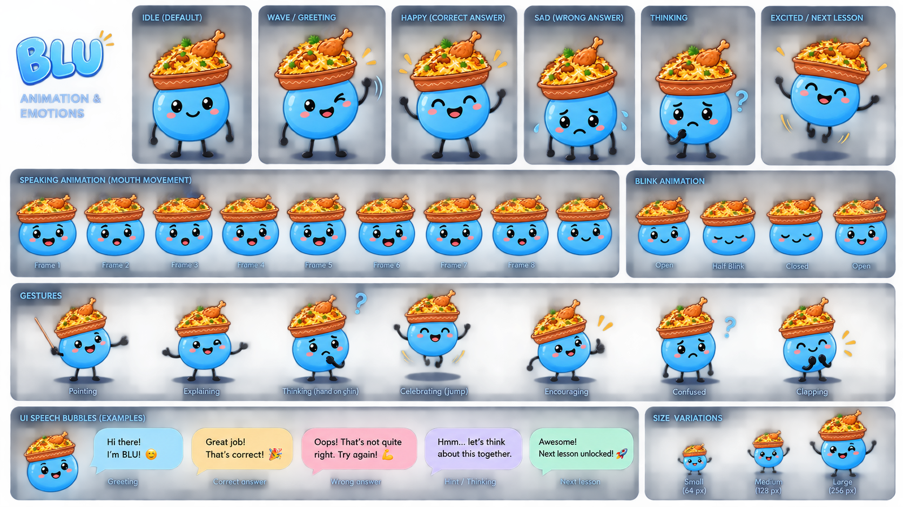

# Biryani.ai — BLU Visual Teacher

> A local-first visual lesson studio that turns a learner’s question into a narrated, animated educational video.

Biryani.ai was built for the **BLU Visual Teacher** challenge. It keeps lesson planning, speech, visual rendering, video export, caching and speech-to-text on the learner’s laptop after one-time model setup. BLU is the friendly visual companion that reacts during learning and quiz feedback.



## What a learner experiences

1. Ask a question by typing or using the speech-to-text microphone.
2. Choose learner level, teaching language, and a 30, 60 or 90 second target.
3. Watch validated lesson scenes begin playing while the final MP4 continues rendering.
4. Read captions, use the scene navigator, and answer a topic-specific quiz.
5. Adjust narration in **Audio refinery** and rebuild a separate MP4 at a slower or faster pace.
6. Reopen matching saved lessons locally without generating the same video again.

## Features

### Local AI lesson pipeline

- **Local planner:** Qwen 3.5 4B via Ollama creates a compact structured storyboard.
- **Validated JSON:** FastAPI and Pydantic reject unsupported scene types, malformed links, invalid animation values, duplicate nodes and unsafe data before rendering.
- **No generated-code execution:** programming examples are display-only. Supported Python `for … range(...)` examples receive a bounded AST-based trace.
- **Progressive playback:** scene narration becomes playable before FFmpeg finishes the 720p MP4.
- **Offline cache:** completed lessons are stored locally with their MP4, VTT captions, JSON plan and metadata. Equivalent requests reuse a saved result; related lessons are clearly labelled as suggestions.

### Dynamic visual teaching

React/SVG scenes are selected from the question’s meaning, not from a prerecorded-video catalog:

| Lesson structure | Visual form |
| --- | --- |
| Classification, types and alternatives | Animated branching tree |
| Related components or fundamental concepts | Radial hub / concept map |
| Repeating process | Circular cycle |
| Sequential mechanism | Directional flow with labelled relationships |
| Concept with no relationship to trace | Clean labelled diagram, without decorative arrows |
| Programming | Code walkthrough and execution trace |
| Maths and numeric relationships | Graphs, equations and transformations |
| Time-based learning | Timeline |
| Physical mechanism | Small relevant animation: pendulum, collision, diffusion, wave, orbit or transfer |
| Two alternatives | Side-by-side comparison |

Flow diagrams are used only where a process, hierarchy, cycle or relationship genuinely needs to be traced.

### Narration, accents and speech input

- Local English neural narration with Indian, British and American accents.
- Local native-language narration for supported Indian languages, including Hindi, Kannada, Tamil, Telugu, Malayalam, Marathi, Bengali, Gujarati, Punjabi and Odia when their model files are installed.
- Local **Faster-Whisper** speech-to-text. The microphone fills the query box with editable recognised text; it does not upload a recording.
- Audio refinery previews a scene locally. Changing its speed changes current playback immediately; applying it creates a separately saved MP4 with regenerated narration.

### BLU companion

BLU is a Three.js-powered 2D-styled character with 3D movement. BLU can greet learners, sit beside the composer and snack while generation runs, celebrate correct answers, and encourage another attempt after an incorrect answer.

## Architecture

```text
Browser UI (Vanilla JS + Three.js)
        │
        ▼
Loopback preview server :53841
        │
        ▼
FastAPI lesson engine :53842
  ├─ Ollama / Qwen local planner
  ├─ semantic visual router + Pydantic validation
  ├─ local TTS + Faster-Whisper STT
  ├─ React/SVG scene renderer
  ├─ FFmpeg / NVENC video export
  └─ SQLite lesson cache + local files
```

All browser-facing services bind to `127.0.0.1`. The application does not require an account, API key, cloud LLM or cloud speech service at runtime.

## Quick start — this laptop

1. Double-click [`START-STUDIO.cmd`](START-STUDIO.cmd).
2. Keep the command window open.
3. Open [http://127.0.0.1:53841](http://127.0.0.1:53841).
4. Choose a language during onboarding, then ask a question.

## Setup on a new Windows laptop

### Prerequisites

- Windows 10/11
- Python **3.12** available through `py -3.12`
- Node.js 20 or newer
- [Ollama](https://ollama.com/)
- An NVIDIA GPU is recommended for fast Ollama planning and NVENC export, but the default animated renderer also works on CPU

### One-time installation

Open a terminal in the project folder and run these scripts in order:

```bat
SETUP-WINDOWS.cmd
SETUP-LOCAL-MODELS.cmd
START-STUDIO.cmd
```

`SETUP-WINDOWS.cmd` creates `.venv`, installs Python dependencies, installs Node packages, and builds the renderer. `SETUP-LOCAL-MODELS.cmd` downloads the local Ollama planner, English voice models, supported native-language voice models and the local speech-to-text model. These downloads require internet once. Runtime generation does not.

Then visit:

```text
http://127.0.0.1:53841
```

### Developer commands

```bat
npm run build
npm run test:motion
npm run test:renderer
.venv\Scripts\python.exe -m pytest tests -q
npm run studio
```

## Stored lesson files

Generated artifacts stay on the local machine:

```text
output/
  lessons/
    <lesson-id>/
      lesson.mp4
      lesson.json
      captions.vtt
      timings.json
      quality.json
  lessons/jobs.sqlite3
```

`output/`, `models/`, `.venv/`, and `node_modules/` are intentionally ignored by Git because they are machine-specific and/or very large.

## GPU and performance

The default `animated` engine is designed for laptop hardware. It uses lightweight SVG/React visuals, local narration, scene-by-scene progressive playback, and FFmpeg/NVENC where available. The app queues one generation job at a time to avoid exhausting laptop memory.

An optional `ltx` engine is present for experimental generative background clips. It requires separately installed LTX weights, CUDA-compatible packages and sufficient VRAM. It is not the default and does not silently substitute unrelated visuals if unavailable.

## Offline promise and limitations

After initial dependencies and model files are installed, lesson planning, text-to-speech, speech-to-text, rendering, captions, caching and export run locally.

- Initial setup and model downloads require internet.
- The local model can still make factual or translation mistakes. Generated content should be reviewed before high-stakes use.
- Speech quality depends on the installed language voice model and laptop hardware.
- A cached lesson is reused only when key settings such as language, learner level, narrator, duration and engine version are compatible.
- The optional LTX workflow has separate hardware and model requirements.

## Technology

- Ollama + Qwen 3.5 4B
- FastAPI + Pydantic + SQLite
- React renderer + SVG + Three.js
- Piper, MMS/Kokoro and Faster-Whisper
- FFmpeg / imageio-ffmpeg
- Node.js local preview server

## Repository hygiene

Do not commit local model weights, virtual environments, generated lessons, log files, caches or `node_modules`. The included `.gitignore` excludes these artifacts.

## License and model notices

Third-party licenses and model notices are available in [`licenses/`](licenses/) and [`docs/`](docs/). Review upstream model and voice licenses before redistribution or commercial use, especially MMS voice models and optional LTX assets.